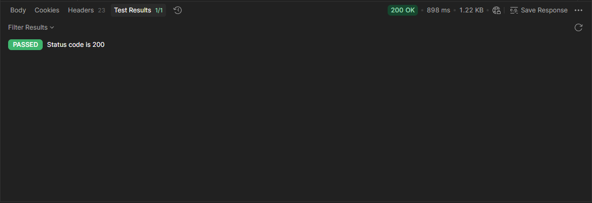
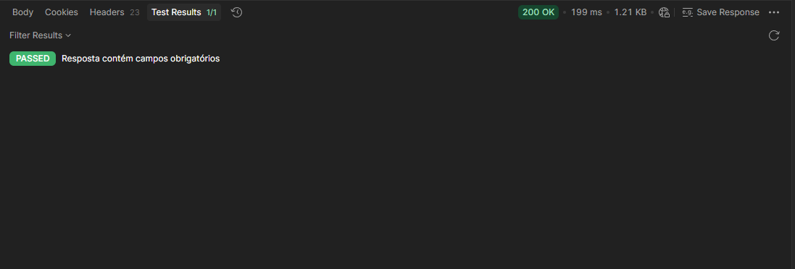
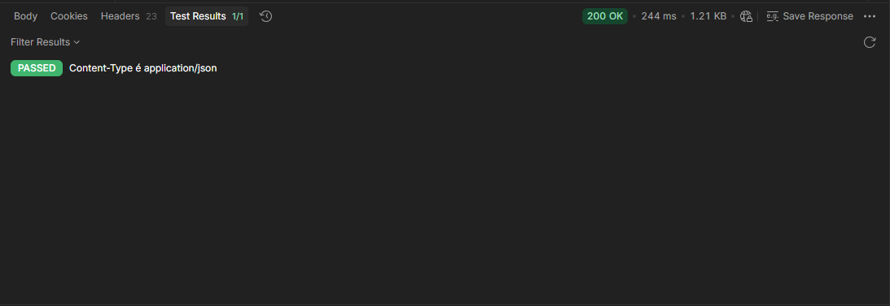
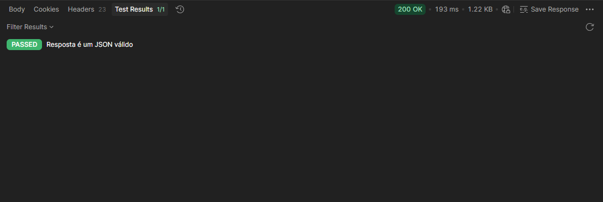
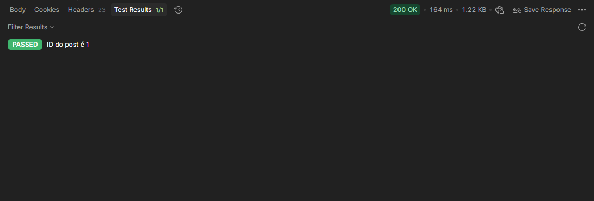
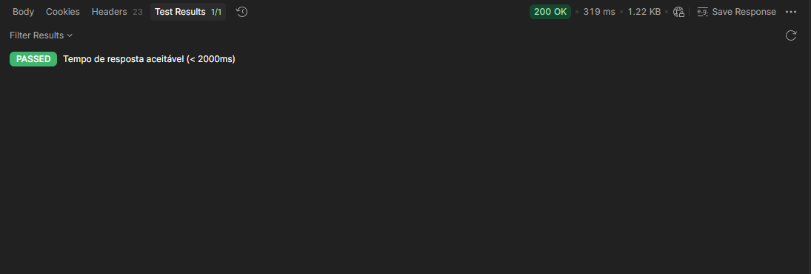
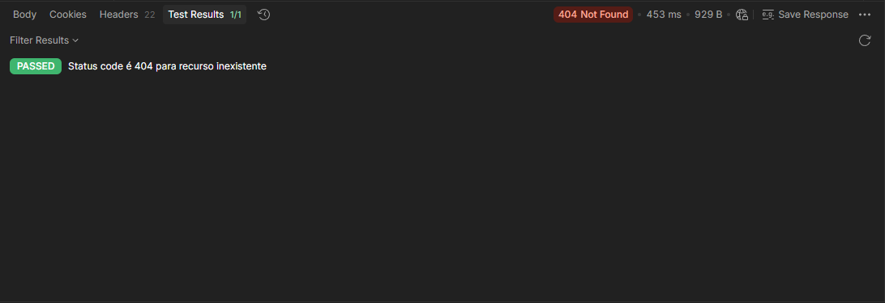
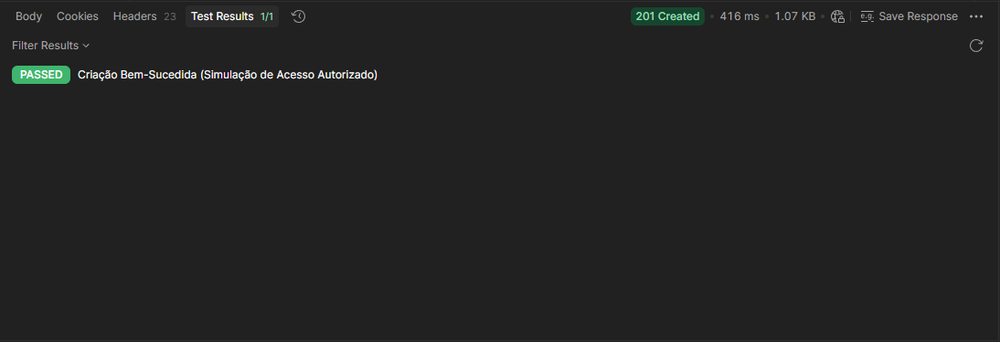
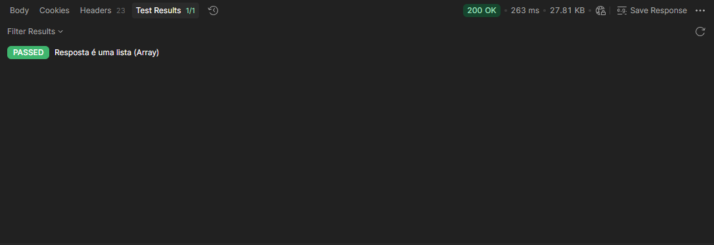
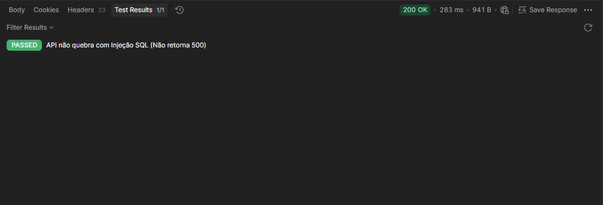

# 10 Boas Práticas de Teste de API

Documento que mostra a execução e saída dos principais testes para boas práticas de testes de APIs

## Configuração Base (JSONPlaceholder)

* Método: GET

* URL: `https://jsonplaceholder.typicode.com/posts/1`
* Objetivo: Este endpoint retorna um único post, ideal para a maioria das validações iniciais.

### 1. Validação do Status Code

Garante que a requisição foi processada com sucesso.

```javascript
// Prática 1: Validação de Status Code (Códigos de Resposta)
pm.test("Status code é 200", function () {
    pm.response.to.have.status(200);
});
```



### 2. Validação de Campos Obrigatórios

Verifica se a resposta JSON possui a estrutura de dados esperada (userId, id, title, body).

```javascript
// Prática 2: Validação de Campos Obrigatórios na Resposta
pm.test("Resposta contém campos obrigatórios", function () {
    const jsonData = pm.response.json();
    pm.expect(jsonData.userId).to.exist;
    pm.expect(jsonData.id).to.exist;
    pm.expect(jsonData.title).to.exist;
    pm.expect(jsonData.body).to.exist;
});
```



### 3. Validação de Tipo de Conteúdo (Content-Type)

Confirma se o servidor retornou o formato correto (JSON).

```javascript
// Prática 3: Validação de Tipo de Conteúdo (Content-Type)
pm.test("Content-Type é application/json", function () {
    pm.response.to.have.header("Content-Type", "application/json; charset=utf-8");
});
```



### 4. Validação de JSON Válido

Garante que o corpo da resposta pode ser analisado como um JSON estruturado.

```javascript
// Prática 4: Validação de JSON Válido
pm.test("Resposta é um JSON válido", function () {
    pm.response.to.have.jsonBody();
});
```



### 5. Validação de Dados Específicos (Ex: ID deve ser 1)

Verifica se os valores retornados correspondem ao esperado (Regra de Negócio).

```javascript
// Prática 5: Validação de Dados Específicos (Ex: ID deve ser 1)
pm.test("ID do post é 1", function () {
    const jsonData = pm.response.json();
    // Verifica se o valor de 'id' é igual a 1
    pm.expect(jsonData.id).to.eql(1);
});
```



### 6. Validação de Tempo de Resposta (Performance)

Garante que a API não está lenta, respondendo dentro de um tempo limite aceitável.

```javascript
// Prática 6: Validação de Tempo de Resposta (Performance)
// Tempo de resposta deve ser menor que 2000ms
pm.test("Tempo de resposta aceitável (< 2000ms)", function () {
    pm.expect(pm.response.responseTime).to.be.below(2000);
});
```



---

## Testes de Cenários Específicos

Para as práticas seguintes, a URL e/ou o Método da requisição serão alterados conforme necessidade do teste.

### 7. Validação de Erro (Cenário 404)

* Objetivo: Garantir que a API retorne o código correto para um recurso não encontrado.

* Ação: Alterar a URL da requisição para um ID inexistente: `https://jsonplaceholder.typicode.com/posts/99999`

```javascript
// Prática 7: Validação de Erro (Cenário 404)
pm.test("Status code é 404 para recurso inexistente", function () {
    pm.response.to.have.status(404);
});
```



### 8. Autenticação (Simulação)

* Objetivo: Simular a verificação de que o acesso foi autorizado após uma ação (como login ou criação).

* Ação: Usar a URL `https://jsonplaceholder.typicode.com/posts`, mudando o Método para POST, e adicionando um
Bearer Token fictício na aba Authorization.
* Body JSON válido:

```json
{
    "title": "foo",
    "body": "bar",
    "userId": 1
}
```

* Bearar Token de exemplo:

```Bearer Token
meu_token_ficticio_12345
```

```javascript
// Prática 8: Validação de Token/Autenticação(Simulação de Sucesso na Criação)
pm.test("Criação Bem-Sucedida (Simulação de Acesso Autorizado)", function () {
// Em APIs reais, você checaria a presença do Token JWT no corpo ou cabeçalho.
    // No JSONPlaceholder, verificamos se a requisição de POST foi aceita (201 Created).
    pm.response.to.have.status(201);
});
```



### 9. Validação de Paginação

* Objetivo: Garantir que a API está retornando dados em formato de lista (Array) e, em APIs reais, que os
metadados de paginação estão presentes.

* Ação: Mudar a URL para `https://jsonplaceholder.typicode.com/posts` (Lista de todos os posts).

```javascript
// Prática 9: Validação de Paginação (Array de Resposta)
pm.test("Resposta é uma lista (Array)", function () {
    const jsonData = pm.response.json();
    pm.expect(jsonData).to.be.an('array');
// Em APIs com paginação real, o teste incluiria:
// pm.expect(pm.response.json()).to.have.property('meta');
});
```



### 10. Verificação de Segurança (SQL Injection)

* Objetivo: SQL Injection é um ataque que insere código SQL malicioso em campos de entrada para
manipular o banco de dados. O teste verifica se a API consegue lidar com essa tentativa de ataque, sem
falhar internamente (Erro 500).

* Ação: Adicionar um parâmetro malicioso na URL: `https://jsonplaceholder.typicode.com/posts?userId='
OR 1=1 --`

> Nota: Usa-se userId como parâmetro simulado para a injeção.

```javascript
// Prática 10: Verificação de Segurança (SQL Injection)
pm.test("API não quebra com Injeção SQL (Não retorna 500)", function () {
    // Uma API robusta deve retornar 200 (ignorando) ou 400 (Bad Request).
    pm.expect(pm.response.code).to.not.eql(500);
    pm.expect(pm.response.code).to.be.oneOf([200, 400]);
});
```


